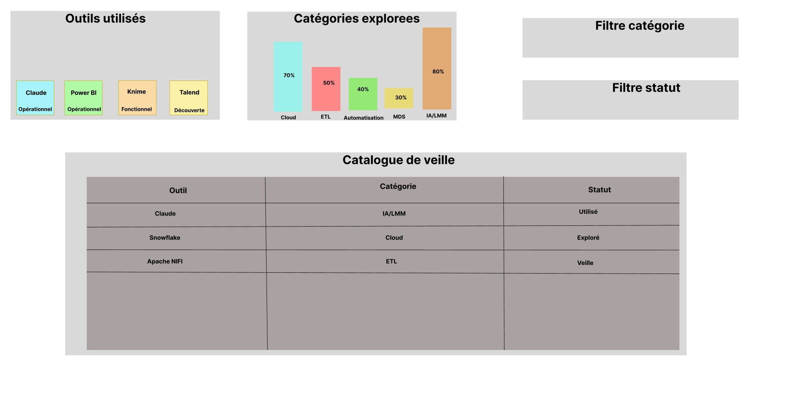

# Pilotage d'un projet data : portfolio pour Aéroworld ⭐

> Mise en situation de chef de projet data : de l'analyse des besoins au livrable final.

## Contexte

Aéroworld, un groupe aéronautique international, recrute un chef de projet en analyse de données. Pour démontrer les 7 compétences attendues, j'ai mené la création de mon portfolio comme un véritable projet client, de bout en bout.

## Démarche

1. **Analyse des besoins métier** : présentation du client, enjeux data, analyse des compétences attendues.
2. **Cahier des charges fonctionnel** : objectifs, périmètre, livrables et critères de validation.
3. **Planification** : diagramme de Gantt et détail des tâches.
4. **Conception** : carte mentale du portfolio, puis maquettes des tableaux de bord.
5. **Réalisation** : deux tableaux de bord Power BI (veille métier et présentation de profil).
6. **Transmission** : documentation de création de graphiques et vidéo de formation Power BI.

## Livrables

| Fichier | Contenu |
|---|---|
| [Analyse des besoins](<Analyse des besoins métier - Aéroworld.pdf>) | Besoins du client et compétences attendues |
| [Cahier des charges](<Cahier des Charges - Projet Portfolio.pdf>) | Cadre, livrables et exigences du projet |
| [Carte mentale](<Carte Mentale Portfolio - Jordan Abderrahmane.pdf>) | Structure du portfolio |
| [Gantt (Excel)](Gantt.xlsx) · [Gantt (Tableau)](Gantt_version_Tableau.twb) · [Détail des tâches](detail_taches.csv) | Planification |
| [Maquette veille](Mock_up_dashboard_veille.jpg) · [Maquette profil](Mock_up_dashboard_profil.jpg) | Maquettes des tableaux de bord |
| [Tableaux de bord](Tableaux_de_bord_veille_et_profil.pbix) | Fichier Power BI |
| [Documentation](Documentation_procedure_graphique_powerBI.pdf) | Procédure de création de graphiques Power BI |

## 🎬 Vidéo de formation Power BI

**[Tutoriel Power BI : visualisations et mesures DAX](https://youtu.be/bQ_rYcBVkGM)** (12 min)

Création de visualisations professionnelles, écriture de mesures DAX et configuration des interactions entre les graphiques.

## Aperçu

## Outils

Power BI · DAX · Tableau · Gestion de projet · Analyse des besoins

