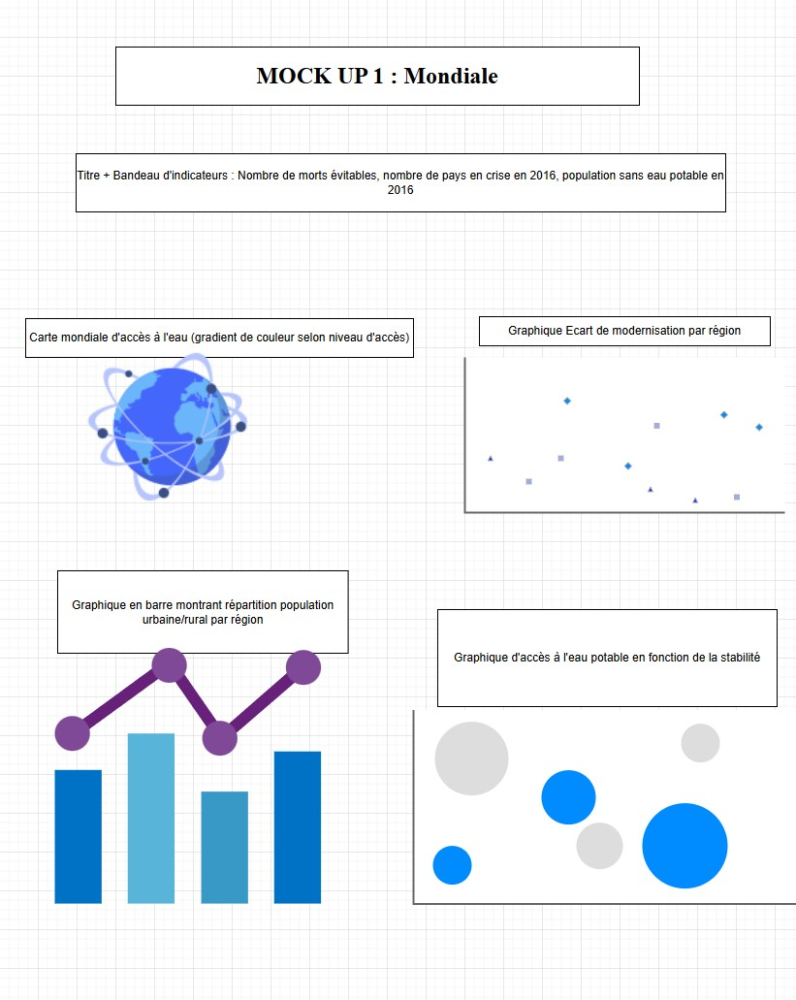

# Tableau de bord : accès à l'eau potable dans le monde

> Outil d'aide à la décision pour une ONG, afin de cibler les pays où ses interventions auront le plus d'impact.

## Contexte

L'ONG Drinking Water For All (DWFA) œuvre pour l'accès à l'eau potable dans le monde, à travers trois domaines d'intervention : la création d'infrastructures, la modernisation des installations existantes et le conseil technique. Elle doit choisir les pays prioritaires pour ses financements.

## Démarche

1. **Données** : sources OMS, FAO et Banque mondiale (accès à l'eau, mortalité infantile, stabilité politique, population).
2. **Préparation** : fusion des données par pays et par année, calcul d'indicateurs dérivés pour chacun des trois domaines d'intervention, agrégations par région.
3. **Conception** : maquettes, puis tableau de bord sur trois niveaux de lecture (mondial, régional, national), avec des filtres par indicateur, domaine et période.
4. **Accessibilité** : palette cohérente, contrastes conformes aux normes WCAG, navigation simple.

## Livrables

| Fichier | Contenu |
|---|---|
| [Tableau de bord](Projet_10_Tableauvffinal.twb) | Classeur Tableau |
| [Présentation](Projet-n10-Tableau-de-bord-danalyse-dacces-a-leau-potable.pptx) | Contexte, démarche et démonstration |
| Maquettes : [1](abderrahmane_jordan_mockup_1.jpg) · [2](abderrahmane_jordan_mockup_2.jpg) · [3](abderrahmane_jordan_mockup_3.jpg) | Maquettes du tableau de bord |

## Aperçu

## Outils

Tableau · Data visualisation · Accessibilité (WCAG)
